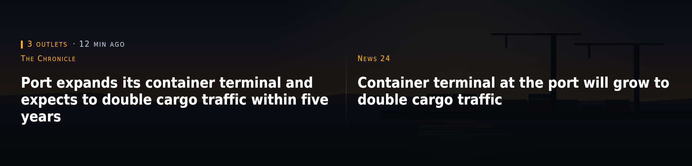
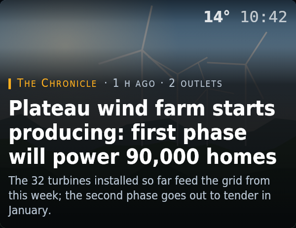

# kiosko-plugin-news

Press headlines from RSS feeds with their photos. No keys and no AI: consensus across outlets measured with plain set overlap.

A plugin for [Kiosko](https://github.com/kiosko-lcd/kiosko), the widget mosaic for small USB LCD panels.



## Install

In Kiosko, **Plugins → Install from npm** → `kiosko-plugin-news`, then restart Kiosko. Or from a terminal:

```sh
npm install --prefix ~/.config/kiosko/plugins kiosko-plugin-news
```

(macOS: `~/Library/Application Support/Kiosko/plugins`, Windows: `%APPDATA%\Kiosko\plugins`.)

## Requirements

- Internet access to the RSS feeds (Spanish outlets by default; any RSS/Atom feed with images works).

## Widgets

### Headline — `news/headline`

One story at a time over its photo, full-bleed: outlet, age, how many outlets carry it, headline and standfirst. With two versions of the same fact side by side when outlets tell it differently.


Uses: `news/deck`, `weather/current`.

| Option | Type | Default | |
|---|---|---|---|
| `rotateMs` | duration (ms) | `30000` | Each story for |
| `offset` | number | `0` | Skip stories. So two news widgets on one screen don't show the same story. |
| `contrast` | boolean | `true` | Two versions side by side. On wide tiles, when two outlets tell the same fact differently. |
| `corner` | boolean | `true` | Clock and weather |

### News column — `news/column`

The current story in a column for a shared screen: photo with rounded corners, clock and temperature on top, headline and standfirst below.



Uses: `news/deck`, `weather/current`.

| Option | Type | Default | |
|---|---|---|---|
| `rotateMs` | duration (ms) | `30000` | Each story for |
| `offset` | number | `1` | Skip stories. So it doesn't repeat the story of a headline widget on the same screen. |
| `corner` | boolean | `true` | Clock and temperature |

## Data sources

### News deck — `news/deck`

Reads the RSS feeds, drops junk and stale items, groups the same story across outlets and orders what to show. Read every 10 min while a widget uses it. Options are set once in Kiosko → Settings → Data sources.

| Option | Type | Default | |
|---|---|---|---|
| `feeds` | list | … | Feeds. Order matters: a repeated story keeps the label of the first feed. |
| `topic` | `all` \| `ai` | `"all"` | Topic |
| `maxAgeHours` | number | `72` | Maximum age. 0: no limit (undated items then pass too). |
| `rejectFilter` | string | … | Discard headlines (regex). Case-insensitive. Empty: keep everything. |
| `poolSize` | number | `60` | Stories in the deck |
| `timeoutMs` | duration (ms) | `15000` | Timeout per feed |

## Development

```sh
npm install
npm test          # node:test
npm run check     # TypeScript
npm run build     # dist/index.js, what Kiosko loads
```

To try it in a running Kiosko without publishing: `kiosko plugins link .` and restart Kiosko.

Working on Kiosko and its plugins together: clone them side by side
(`kiosko/` and `kiosko-plugins/kiosko-plugin-news/`) and run `npm install` in
`kiosko/`; its workspaces link every plugin found in `../kiosko-plugins`.

## License

MIT
