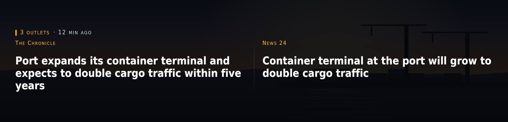
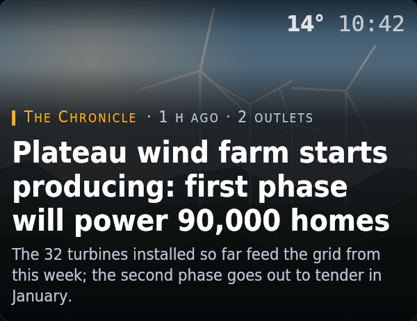

# kiosko-plugin-news

Press headlines from RSS feeds with their photos. No keys and no AI: consensus across outlets measured with plain set overlap.

A plugin for [Kiosko](https://github.com/kiosko-lcd/kiosko), the widget mosaic for small USB LCD panels.



## Install

In Kiosko, **Plugins → Install from npm** → `kiosko-plugin-news`, then restart Kiosko. Or from a terminal:

```sh
npm install --prefix ~/.config/kiosko/plugins kiosko-plugin-news
```

(macOS: `~/Library/Application Support/Kiosko/plugins`, Windows: `%APPDATA%\Kiosko\plugins`.)

## Requirements

- Internet access to the RSS feeds (by default, well-known outlets in your language: English, Spanish, Traditional Chinese from Taiwan or Simplified Chinese from the mainland; any RSS/Atom feed with images works).

## What it does on your machine

- **Internet**: contacts the ones you set in its options.

- Uses `weather/current` from [kiosko-plugin-weather](../kiosko-plugin-weather) when it is there.

## Widgets

### Headline — `news/headline`

One story at a time over its photo, full-bleed: outlet, age, how many outlets carry it, headline and standfirst. With two versions of the same fact side by side when outlets tell it differently.


Uses: `news/deck`, `weather/current`.

| Option | Type | Default | |
|---|---|---|---|
| `rotateMs` | duration (ms) | `30000` | Each story for |
| `outlets` | list | `[]` | Outlets. Empty: all. Feed names as in the news source (El País, Xataka IA…), comma-separated; * matches anything, a leading ! leaves out. A story carried by several shows the version of one of these. |
| `topics` | list | `[]` | Topics. Empty: every story. Words looked for in the headline and standfirst, comma-separated: a story stays if it mentions any; a leading ! leaves out the ones that mention it. Case and accents don't matter, and a word matches at the start of a word (ia finds «IA», not «familia»). |
| `showStandfirst` | boolean | `true` | Standfirst. The summary under the headline. Off: the headline alone, with room for longer ones. |
| `offset` | number | `0` | Skip stories. So two news widgets on one screen don't show the same story. |
| `showContrast` | boolean | `true` | Two versions side by side. On wide tiles, when two outlets tell the same fact differently. |
| `showCorner` | boolean | `true` | Clock and weather |

### News column — `news/column`

The current story in a column for a shared screen: photo with rounded corners, clock and temperature on top, headline and standfirst below.



Uses: `news/deck`, `weather/current`.

| Option | Type | Default | |
|---|---|---|---|
| `rotateMs` | duration (ms) | `30000` | Each story for |
| `outlets` | list | `[]` | Outlets. Empty: all. Feed names as in the news source (El País, Xataka IA…), comma-separated; * matches anything, a leading ! leaves out. A story carried by several shows the version of one of these. |
| `topics` | list | `[]` | Topics. Empty: every story. Words looked for in the headline and standfirst, comma-separated: a story stays if it mentions any; a leading ! leaves out the ones that mention it. Case and accents don't matter, and a word matches at the start of a word (ia finds «IA», not «familia»). |
| `showStandfirst` | boolean | `true` | Standfirst. The summary under the headline. Off: the headline alone, with room for longer ones. |
| `offset` | number | `1` | Skip stories. So it doesn't repeat the story of a headline widget on the same screen. |
| `showCorner` | boolean | `true` | Clock and temperature |

### Topics without profiles

`topics` keeps only the stories that mention some words, in the headline or the standfirst of any outlet's version: `fútbol, liga` for sports, `ia, !apple` for AI without Apple. With the general feeds this already gives a themed tile; profiles are for when the topic has feeds of its own.

## Data sources

### News deck — `news/deck`

Reads the RSS feeds, drops junk and stale items, groups the same story across outlets and orders what to show. Read every 10 min while a widget uses it. Options are set in Kiosko → Settings → Data sources.

**Profiles** (Kiosko 0.2.12 and later): the deck can have several named configurations, say «General», «Technology» and «Sports», each with its own feeds (the sections of each paper have their own RSS). Each profile is read on its own and groups its own stories, so «carried by 4 outlets» counts within the profile. A widget picks its profile in the inspector (**Source profile**), where **New profile…** makes one from the tile itself; Settings → Data sources shows them as tabs. A feed that two profiles list is downloaded once. With older Kiosko versions there is one deck, as before.

| Option | Type | Default | |
|---|---|---|---|
| `feeds` | list | `[]` | Feeds. Empty: well-known outlets in your language. Order matters: a repeated story keeps the label of the first feed. |
| `topic` | `all` \| `ai` | `"all"` | Topic |
| `maxAgeMs` | duration (ms) | `259200000` | Maximum age. 0: no limit (undated items then pass too). |
| `rejectFilter` | string | … | Discard headlines (regex). Case-insensitive. Empty: keep everything. |
| `maxStories` | number | `60` | Stories in the deck |

## Development

```sh
npm install
npm test          # node:test
npm run check     # TypeScript
npm run build     # dist/index.js, what Kiosko loads
```

To try it in a running Kiosko without publishing: `kiosko plugins link .` and restart Kiosko.

Working on Kiosko and its plugins together: clone them side by side
(`kiosko/` and `kiosko-plugins/kiosko-plugin-news/`) and run `npm install` in
`kiosko/`; its workspaces link every plugin found in `../kiosko-plugins`.

## License

MIT
